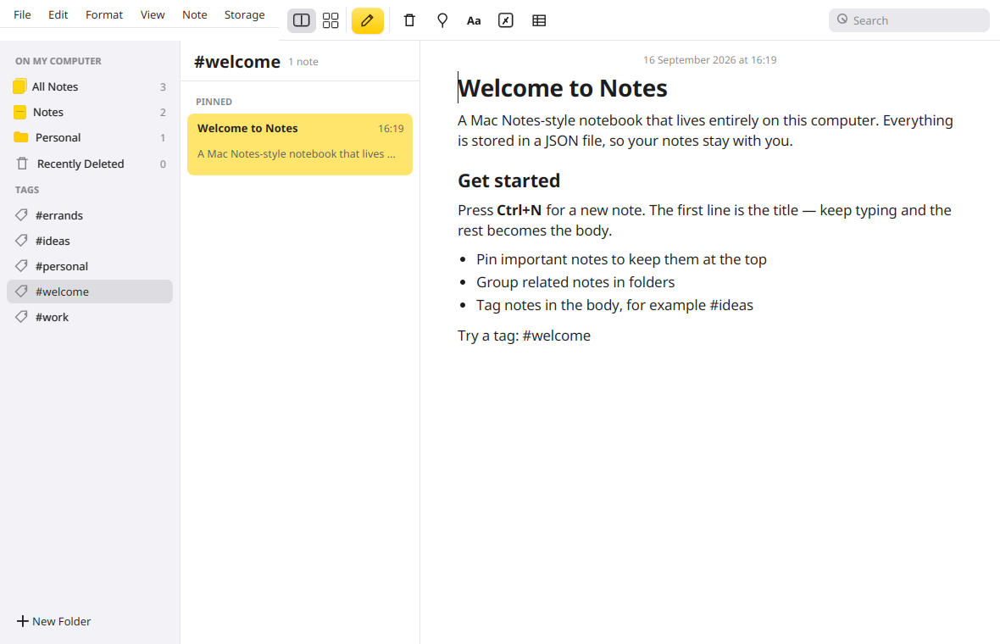

# Notes

A Mac Notes–style desktop notebook for Java 21. Three panes (folders, note list, editor), rich text, local JSON storage, and a yellow compose button where it belongs.



## Requirements

- **JDK 21**
- **Maven 3.8+**

On this project, Java 21 from SDKMAN works as:

```bash
export JAVA_HOME="$HOME/.sdkman/candidates/java/21.0.9-amzn"
export PATH="$JAVA_HOME/bin:$PATH"
```

Use any JDK 21; the `JAVA_HOME` path will differ on your machine.

## Run from source

```bash
mvn javafx:run
```

## Build an executable JAR

```bash
mvn package
java -jar target/notes.jar
```

That produces a single fat JAR at `target/notes.jar` (JavaFX and Jackson included). You still need Java 21 to run it.

The JAR is built for the OS you package on. JavaFX ships native libraries, so a Linux build will not run on Windows, and vice versa. Run `mvn package` on each platform you want to distribute.

## Tests

```bash
mvn test
```

## Storage

Notes and settings are plain JSON files next to each other. **Storage → View data** opens this folder in the system file manager.

| File | Purpose |
| --- | --- |
| `notes.json` | Folders and notes |
| `settings.json` | App preferences (theme, and room for more later) |

| OS | Directory |
| --- | --- |
| Linux | `~/.local/share/notes-app/` |
| Windows | `%APPDATA%\NotesApp\` |
| macOS | `~/Library/Application Support/NotesApp/` |

If you delete `notes.json`, the next launch creates a new one and seeds the sample notes. Theme is stored separately in `settings.json` (`system`, `light`, or `dark`).

## Features

- Three-pane layout in the style of Apple Notes
- Folders, tags (`#work`), pin, search, list and gallery views
- Per-note read-only checkbox: checked notes cannot be edited
- Rich text: title, heading, lists, checklists, tables, highlight
- Soft-delete to Recently Deleted (purged after 30 days); Erase All permanently deletes every note in the trash
- Light and dark theme (follows the desktop until you toggle it)
- Auto-save to JSON

## Keyboard shortcuts

| Action | Shortcut |
| --- | --- |
| New note | `Ctrl+N` / `Cmd+N` |
| New folder | `Ctrl+Shift+N` / `Cmd+Shift+N` |
| Find | `Ctrl+F` / `Cmd+F` |
| Title / heading / subheading / body | `Ctrl+1` … `Ctrl+4` |
| Bold / italic / underline | `Ctrl+B` / `I` / `U` |
| Checklist | `Ctrl+L` |
| Pin note | `Ctrl+Shift+P` |

On macOS, `Ctrl` in the table is the Command key.

## Author

Created by **Grok 4.6**, built by [xAI](https://x.ai).
